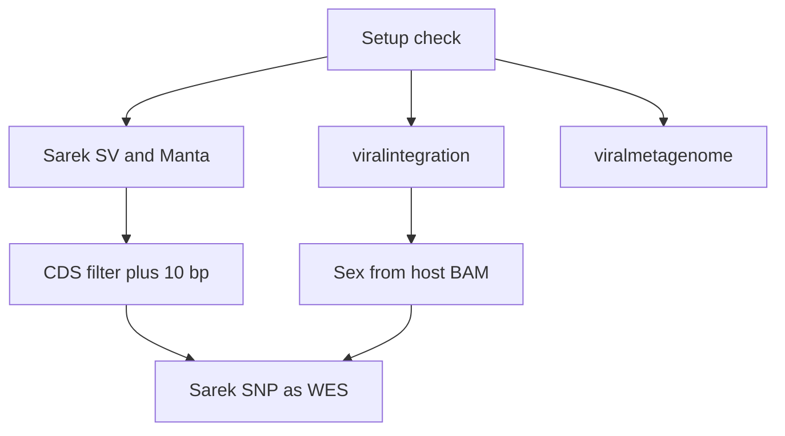

# AllCall

Bash-first orchestration for human or mouse WGS cohorts: a **site** YAML for per-run settings (including `species`), a versioned **pin** manifest for per-species references and pipeline revisions, one germline samplesheet, and thin wrappers around [nf-core](https://nf-co.re/) viralintegration, Sarek (SV + SNP), and viralmetagenome.

Workflow design: [`docs/plans/2026-10-20-wgs-pipeline-workflow.md`](docs/plans/2026-10-20-wgs-pipeline-workflow.md).

## Progress

| Step | Status |
|------|--------|
| Host tools in `opt/` (Bash 5, Java 17, yq, samtools, kraken2-build) | Done |
| UCSC host FASTA and ncbiRefSeq GTF (hg38 or mm39 via `species`) | Done |
| Virus FASTA (CTAT nr + local inserts) | Done |
| Nextflow 26.10.3 and pinned nf-core pulls | Done |
| Sample-sheet expansion | Done |
| Kraken2 host database | Paused |
| Cohort FASTQs and `samplesheets/cohort.csv` | Not started |
| Site Nextflow configs | Local overlay in `config/nextflow/` |
| Launch viralintegration, Sarek SV, viralmetagenome | Not started |
| CDS filter, sex check, Sarek SNP | Not started |

## Workflow



Viral integration, Sarek SV, and viralmetagenome start together. Sarek SNP starts after the CDS filter. Sex is inferred from chrX/chrY (or `X`/`Y`) read counts in the viralintegration host BAM when that BAM exists. One failure does not stop the other runs.

## Requirements

`./bin/setup.sh` installs Bash 5, Java 17, `yq`, `samtools`, and `kraken2-build` into `opt/` from the versions in [`config/pin.yaml`](config/pin.yaml). Later scripts use `opt/env.sh` and do not need those tools from a module or the system `PATH`. Bash 5 is included because the scripts use it, and macOS still ships Bash 3.

Still required on the machine:

- `bash` (any version) and `curl`, so setup can start and download the rest
- `python3`, for the virus FASTA merge only
- Docker or Apptainer/Singularity (`container_profile` in site config). Setup checks for one of these and does not install it.

Install or refresh only the host tools:

```bash
./bin/setup.sh --tools-only
```

## Configure (two files)

| File | Who edits | Contents |
|------|-----------|----------|
| [`config/pin.yaml`](config/pin.yaml) | Maintainers on reference/pipeline bumps | Per-species UCSC FASTA/GTF URLs and MD5s (`species.human`, `species.mouse`), virus asset URLs/paths, Kraken2 DB path per species, nf-core **name + revision** per pipeline, Nextflow version/bin/home |
| [`site.config.yaml`](site.config.yaml) (copy from [`example.config.yaml`](example.config.yaml)) | You per site/run | `species` (`human` or `mouse`), `scratch_root`, `work_dirs`, `samplesheet`, `results_dir`, pipeline **enabled** flags and Sarek tool choices, `container_profile`, optional `nextflow_configs` overlays |

`bin/lib.sh` loads **`config/pin.yaml` first**, then your site file (`ALLCALL_PIN` overrides the pin path). Keys should not overlap; site values win if they do. After merge, `species` selects `references` and `kraken2_db` from `species.<name>` in the pin (default `human` if omitted).

1. Copy and edit `site.config.yaml` (`species`, `scratch_root`, `samplesheet`, `container_profile`, enable/disable pipelines). Use `species: human` for hg38 or `species: mouse` for mm39; `./bin/setup.sh` downloads the matching UCSC FASTA and ncbiRefSeq GTF.
2. Cohort sheet: `sample`, `fastq_1`, `fastq_2` (optional `lane`). See [`samplesheets/cohort.csv.example`](samplesheets/cohort.csv.example).
3. Create `ref/virus/local/` and add optional extra viral `.fa` / `.fasta` files before setup.

## Setup → check → run

```bash
chmod +x bin/*.sh
./bin/setup.sh site.config.yaml
./bin/check.sh site.config.yaml
./bin/run_cohort.sh --config site.config.yaml --run-name cohort01
```

Dry-run (prints four `nextflow run … -resume` commands and writes `running` in the matrix):

```bash
./bin/run_cohort.sh --config site.config.yaml --dry-run
```

Status matrix: `results/<run-name>/matrix.tsv`.

## Local workstation

For a laptop (local Nextflow executor, no UMN `/scratch.global` paths), use [`config/local.config.yaml`](config/local.config.yaml).

**Layout.** Nextflow work directories live under `scratch_root` (default `~/Documents/projects/allcall/scratch`; `~` and `$HOME/...` are expanded in [`bin/lib.sh`](bin/lib.sh)). Cohort outputs (`results/<run-name>/`, matrix, sheets) stay in the repository via `results_dir: results`, same as the HPC example. Create the scratch tree before setup/check:

```bash
mkdir -p ~/Documents/projects/allcall/scratch data ref/virus/local
```

**Containers.** [`config/local.config.yaml`](config/local.config.yaml) defaults to `container_profile: docker` (Docker Desktop on Mac). On Linux HPC, set `container_profile: apptainer` when Apptainer/Singularity is on `PATH`. Pipeline revisions stay pinned in [`config/pin.yaml`](config/pin.yaml).

[`config/nextflow/local.config`](config/nextflow/local.config) sets the local executor, modest CPU/memory caps, and container notes (Apptainer `singularity.runOptions` or Docker via nf-core `-profile docker`).

```bash
cp config/local.config.yaml site.config.yaml   # optional; or pass the path below
./bin/setup.sh --tools-only                    # fast path: host tools only
./bin/setup.sh config/local.config.yaml        # full setup: refs, Nextflow pulls, Kraken build
./bin/setup.sh --skip-kraken config/local.config.yaml   # skip Kraken2 DB build (Mac phase 1 / low disk)
./bin/check.sh config/local.config.yaml
./bin/run_cohort.sh --config config/local.config.yaml --dry-run
```

Edit [`samplesheets/cohort.local.example`](samplesheets/cohort.local.example) (or copy to `samplesheets/cohort.csv`) so `fastq_*` point at real FASTQs under `data/`. Reference downloads and Kraken2 still need disk and network for a full run; dry-run and config tests do not execute pipelines.

### Security (local runs)

- Run AllCall and Nextflow as your normal user, not root; keep `container_profile` on apptainer/docker profiles that map the invoking UID (`-u` / non-root Docker).
- Use pinned nf-core revisions from `config/pin.yaml`; rebuild or pull images when you bump pins.
- Keep `scratch_root` and `results/` outside web-served or world-writable directories.
- Avoid `--privileged` and unnecessary host bind mounts; prefer contained Apptainer (`--containall --no-home`) unless a pipeline documents extra binds.
- Treat cohort FASTQs and BAMs as sensitive data; restrict filesystem permissions on scratch and results.

## Scripts

| Script | Role |
|--------|------|
| `bin/setup.sh` | References, virus merge, Nextflow install/pull, Kraken2 DB |
| `bin/check.sh` | Same gates as setup, no downloads |
| `bin/write_sheets.sh` | Simple sheet → pipeline CSVs |
| `bin/run_cohort.sh` | Cohort driver (VI, SV, VM parallel; CDS + SNP when ready) |
| `bin/merge_virus_fasta.sh` | CTAT + local virus FASTA merge |
| `bin/cds_bed.sh` | CDS intervals from GTF (+ flank) |

## Tests

```bash
./tests/smoke.sh
```

CI runs `shellcheck` (when available) and fixture smoke tests only — no UCSC downloads, no Nextflow install.
