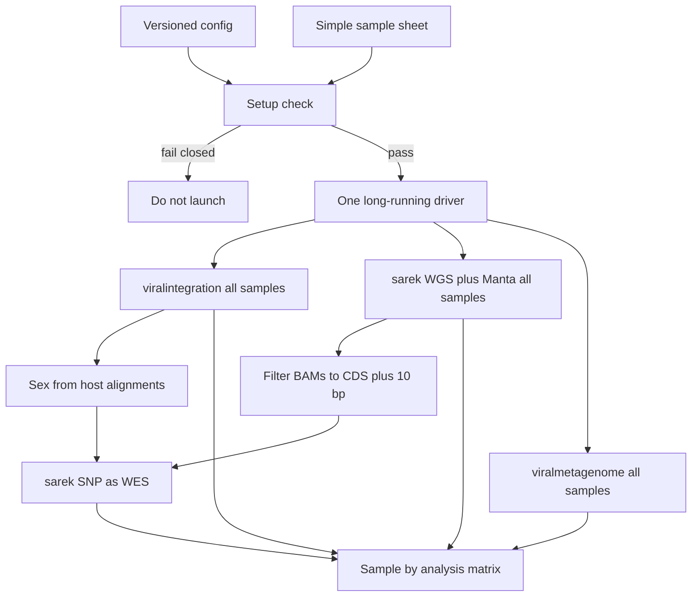

# Mouse WGS multi-pipeline workflow

Archived 2026-10-20. Snapshot of the agreed workflow plan.

A small orchestrator around upstream nf-core pipelines. It does not reimplement alignment or variant calling. It prepares a project-local environment, checks that preparation, and starts one long-running driver that runs every sample through the analyses below.

There is one driver for the cohort, not one driver per sample. About twenty samples stay in one samplesheet per analysis. Nextflow schedules those samples in parallel.

## What one run does



Setup is a gate. The driver starts only after it passes. Viral integration, the Sarek SV run, and viral metagenome start together. Each is one Nextflow run containing every sample. Sarek SNP is a second Sarek run and starts after WGS BAMs exist and have been restricted to CDS plus 10 bp. Sex is filled from viralintegration alignments before that SNP run.

If one analysis exits with an error, the others keep going. A sample that fails inside one analysis is marked failed in that column; the other samples in that analysis continue, and the other analyses are left alone. Sarek SNP includes only samples that have a filtered BAM. A sample with no viralintegration alignment is still called, with sex left as `NA`.

## The analyses

All of them read paired-end Illumina FASTQ. Every sample is germline. There are no tumor-normal pairs. In Sarek sheets, `patient` equals `sample` and `status` is `0`.

- **nf-core/viralintegration** — chimeric-read viral integration. Samplesheet: `sample`, `fastq_1`, `fastq_2`. Host reference is the mm39 FASTA and GTF. Virus reference is the merged FASTA from setup. Work directory name: `nfVI`.
- **nf-core/sarek, SV pass** — WGS from FASTQ through alignment, then Manta only (`--tools manta`). No SNP caller on the full genome. Custom genome: `--genome null --igenomes_ignore --fasta` plus the GTF. Work directory name: `nfSarekSV`.
- **CDS filter** — from the SV-pass BAMs, keep reads overlapping CDS features from the same GTF, expanded by 10 bp. Write a BED of those intervals and the filtered BAMs.
- **nf-core/sarek, SNP pass** — second Sarek run on the filtered BAMs, treated as WES (`--wes` plus that intervals BED). SNP caller defaults to `haplotypecaller` and is set in config. Sex column comes from the check below. Work directory name: `nfSarekSNP`.
- **nf-core/viralmetagenome** — assemble sequence that is not host. Samplesheet: `sample`, `fastq_1`, `fastq_2`. Host removal uses a Kraken2 database built from the same mm39 FASTA, not the FASTA path itself. Work directory name: `nfVirMeta`.

Pinned pipeline revisions live in the config. Parameters go in a generated params file. Nextflow `-c` is for executor, containers, resources, and the site workaround configs.

Every Nextflow command is launched with `-resume`, so a second run skips steps that already completed in that analysis's work directory.

## Sex

Sex is not in the simple sheet. After viralintegration has a host alignment for a sample, a small check compares chrX and chrY counts in that BAM (UCSC mm39 names) and writes `XX` or `XY`. The threshold lives in config. The result is a one-column table the SNP samplesheet reads. Sarek SV does not wait on it; Manta does not use sex.

## One simple sheet

Required columns: `sample`, `fastq_1`, `fastq_2`. Optional: `lane`, when a sample has more than one FASTQ pair. Rows with the same `sample` are lanes of one germline sample.

The driver writes one sheet per analysis under the run directory. Paths in those sheets are absolute. The simple sheet may use paths relative to the project root. The SNP sheet is written later, once filtered BAMs and the sex table exist, and its input column is the filtered BAM rather than FASTQ.

## One versioned config

One YAML file is the input to the runner. Scientific paths are relative to the project root. The scratch root is the exception: on this HPC it is an absolute path, and other sites replace that one value.

```yaml
scratch_root: /scratch.global/bmcc
work_dirs:
  viralintegration: nfVI
  sarek_sv: nfSarekSV
  sarek_snp: nfSarekSNP
  viralmetagenome: nfVirMeta
```

Resolved work paths are `scratch_root` plus those names: `/scratch.global/bmcc/nfVI`, and the same for `nfSarekSV`, `nfSarekSNP`, and `nfVirMeta`. Results stay in the project tree. Only Nextflow work directories use scratch.

The config also records:

- UCSC mm39 FASTA and GTF URLs, local paths, and checksums
- Local directory of extra viral sequences, and the output path of the merged virus FASTA
- Kraken2 host-database path
- Pipeline revisions, SNP caller, and sex-check threshold
- Container profile: `docker` locally, `apptainer` on HPC
- Simple sample-sheet path and results directory
- Which analyses are enabled
- Paths to extra Nextflow config files

**Site Nextflow configs are not written yet.** Problems already hit on this cluster will be handled by config files supplied later. The runner will pass them with `-c` in a fixed order. Until those files exist, the hook is an empty list in the config, and nothing is invented in their place.

Scheduler account and walltime can sit in a small overlay so the scientific config stays stable. The driver job itself asks for a long walltime on one node. Nextflow, not a per-sample wrapper, fans work out to the cluster.

## Setup, checked before any sample is launched

Setup is idempotent and project-local. `NXF_HOME` and the Nextflow binary live inside the project. Nothing is installed into a home directory or a shared module tree.

Virus FASTA is built here, not downloaded as a finished product:

1. Take the viral FASTA shipped with the pinned nf-core/viralintegration release (the CTAT virus database that pipeline defaults to).
2. Append every sequence from the configured local directory.
3. Deduplicate by sequence name. The local copy wins when a name is in both. A short report lists kept, added, and replaced names.

The check fails the run if any of these are missing or do not match the recorded checksum:

- Nextflow binary and a working Java
- The selected container runtime
- mm39 FASTA and GTF from UCSC
- Merged virus FASTA and its dedup report
- Kraken2 host database built from that mm39 FASTA
- Pinned pipeline revisions cached locally
- Simple sheet parses, FASTQs exist, and the FASTQ-based sheets match each pipeline schema
- Scratch root exists and is writable

`setup` can be run by itself. `run` always calls the same check and stops if it fails.

## How the driver runs

One process launches the Nextflow runs. It does not start a new process tree per sample.

- Viralintegration, Sarek SV, and viralmetagenome are started together. Each receives the full cohort.
- As Sarek SV writes BAMs, the CDS filter runs per sample. One sample's failure does not block the others.
- When a viralintegration host BAM exists, sex is recorded for that sample.
- One Sarek SNP Nextflow run then starts for every sample that has a filtered BAM, with `-resume`.
- The driver stays up until those runs have exited, and rewrites the matrix at each launch and exit.

## The matrix

Two files, rewritten when an analysis is launched and when it finishes:

- A TSV for diffs and tests
- An HTML table for a person to open in a browser

Rows are samples. Columns are `viralintegration`, `sarek_sv`, `cds_filter`, `sarek_snp`, and `viralmetagenome`. Cells are `not_started`, `running`, `succeeded`, or `failed`. A failed cell points at that analysis's log and the sample's expected output. Refreshing the HTML file shows the latest write. There is no status server.

Per-sample failure inside one Nextflow run comes from that run's trace. A run-level crash marks still-running samples in that column as failed and leaves the other columns untouched.

## How this stays checkable

Each step is usable on its own before the next one exists:

1. Config load, germline sheet expansion, and work-path joining, proven with fixture files
2. Virus FASTA merge and name-dedup on tiny FASTA fixtures
3. Setup check against a fake reference directory, with downloads mocked
4. Sex check on a tiny BAM fixture
5. CDS BED from a tiny GTF, plus the BAM-filter command
6. Matrix writer fed by fake exit codes and trace files
7. Launcher dry-run that prints four `nextflow run ... -resume` commands and writes `running` into the matrix
8. Real setup and a tiny FASTQ smoke run, outside ordinary CI

GitHub Actions runs the fixture tests on every pull request. It does not download mm39 or execute the pipelines. Full data runs happen where the project is deployed.

The result is an installable package pulled from GitHub. A checkout plus the config is the project prefix. Genomes, databases, and the Nextflow installation stay inside that tree. Work directories follow `scratch_root`, so the HPC layout can change later without changing the analyses.
